# Bye Bye Paper — Business Presentation & Franchise Overview

---

## 🌐 English Version

---

### 📖 About the Project

**Bye Bye Paper** is an innovative digital business franchise centered around **electronic document management and paperless transformation**. By helping companies eliminate paper waste and transition to streamlined digital workflows, Bye Bye Paper provides significant cost savings, operational efficiency, and environmental sustainability.

#### Key Highlights & Topics:
1. **Easy Deployment (Implantação):**
   - High ease of deployment thanks to a digital-first business model.
   - Requires no complex physical installations.
   - Comprehensive franchisee support including initial training, operational guidance, and quick setup turnaround.
2. **Investment & Return (Investimento):**
   - Accessible initial investment without needing extensive physical facilities.
   - Operational costs limited to labor, equipment maintenance, software licensing, and minimal overhead.
   - High ROI potential driven by growing market demand for paperless solutions.
3. **Flexible Location (Localização):**
   - Operable in various geographic locations and smaller population centers.
   - Flexible work models including partial or full **Home Office** operations.
   - Advantageous proximity to commercial and industrial centers.
4. **Target Market & Consumers (Consumidores):**
   - High market acceptance driven by digital transformation trends, sustainability concerns, and operational cost reduction.
   - Businesses spend an estimated **$31,000 to $50,000 annually on paper** alone.
5. **Workforce & Automation (Mão de Obra):**
   - Requires skilled staff proficient in document management and information security software.
   - High level of process automation reduces labor dependencies.
   - Complete training programs provided by the franchisor.
6. **Ease of Management (Facilidade de Gestão):**
   - Standardized operational processes and continuous franchisor support.
7. **Future Objectives (Objetivos Futuros):**
   - Client cost reduction, operational efficiency improvements, top-tier information security, and environmental sustainability.

---

### 🚀 How to Open and View the Project

1. **View via PDF Viewer / Web Browser:**
   - Download or locate `bye_bye_paper.pdf` in the repository root.
   - Double-click `bye_bye_paper.pdf` or drag and drop it into any modern browser (Google Chrome, Firefox, Edge, Safari) or PDF viewer (Adobe Acrobat, Preview, Evince).
2. **View via Document Screenshots:**
   - Scroll down to the [Demonstration / Screenshots](#-demonstration--screenshots) section below to view all presentation slides directly in your browser.

---

### 🖼️ Demonstration / Screenshots

| Slide | Preview |
| :---: | :--- |
| **Page 01** - Cover | 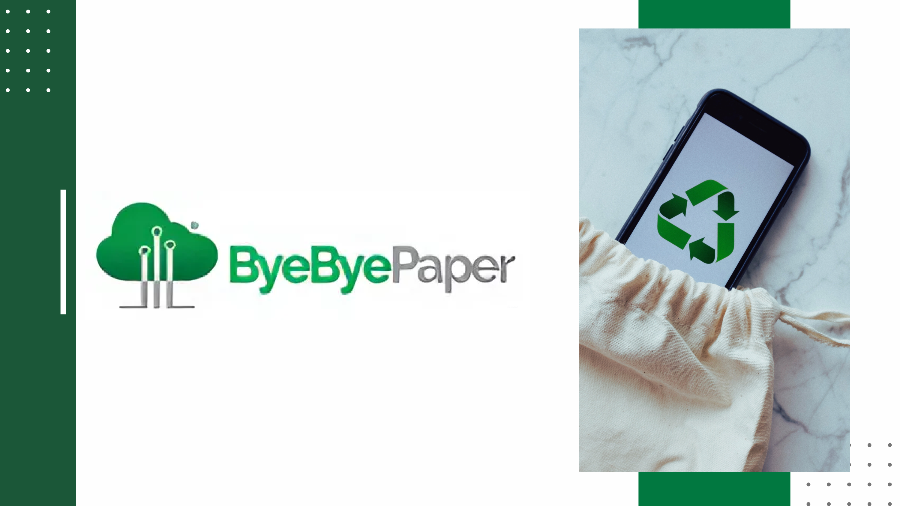 |
| **Page 02** - Topics | 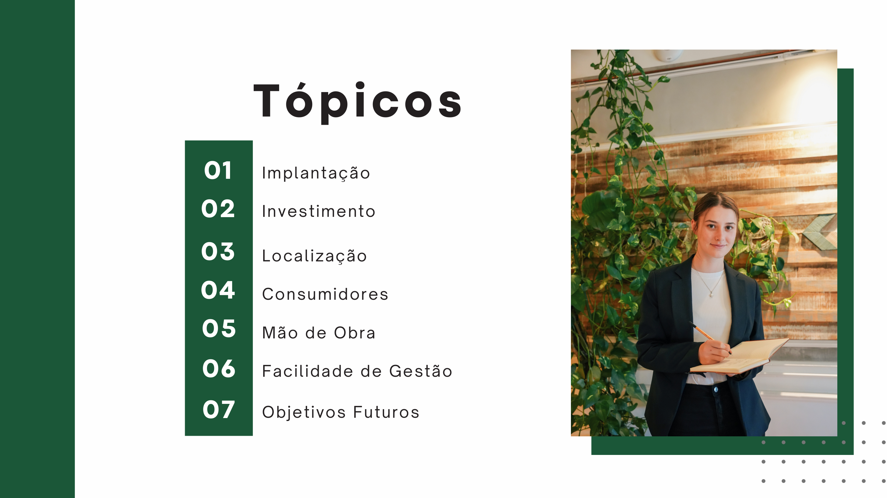 |
| **Page 03** - Deployment | 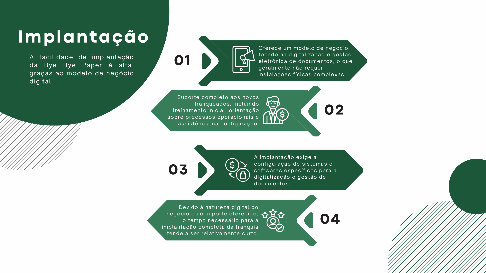 |
| **Page 04** - Investment | 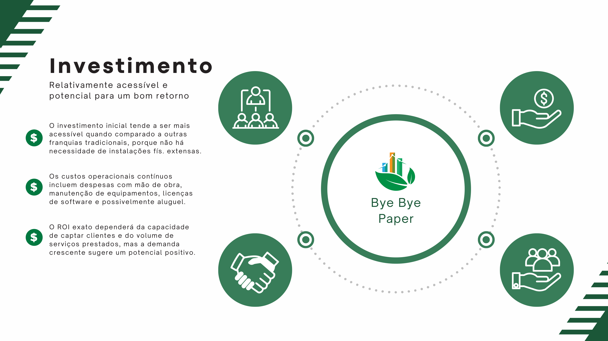 |
| **Page 05** - Location | 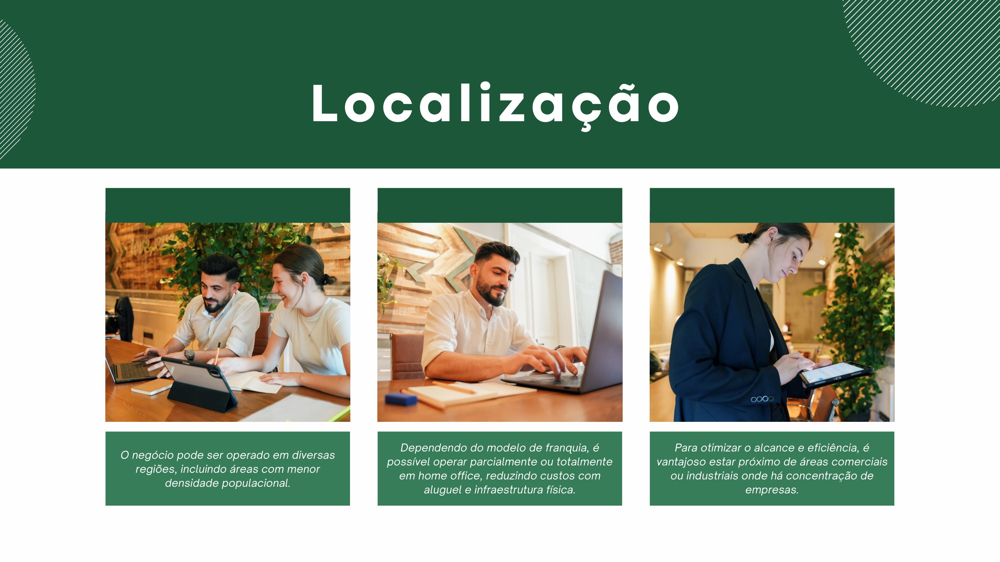 |
| **Page 06** - Consumers & Market | 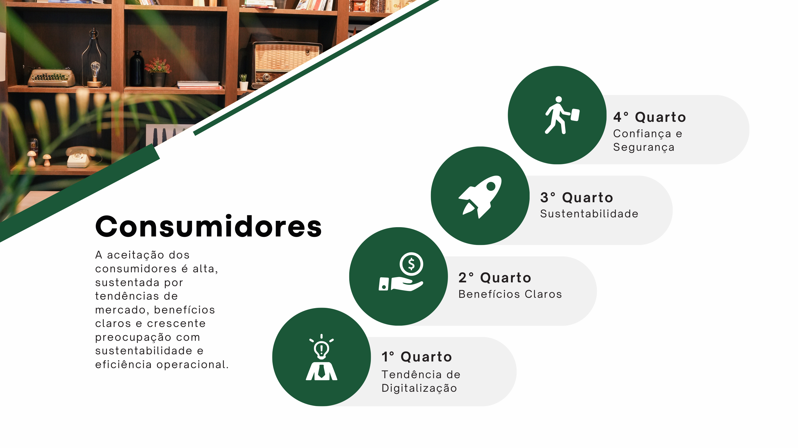 |
| **Page 07** - Workforce & Automation | 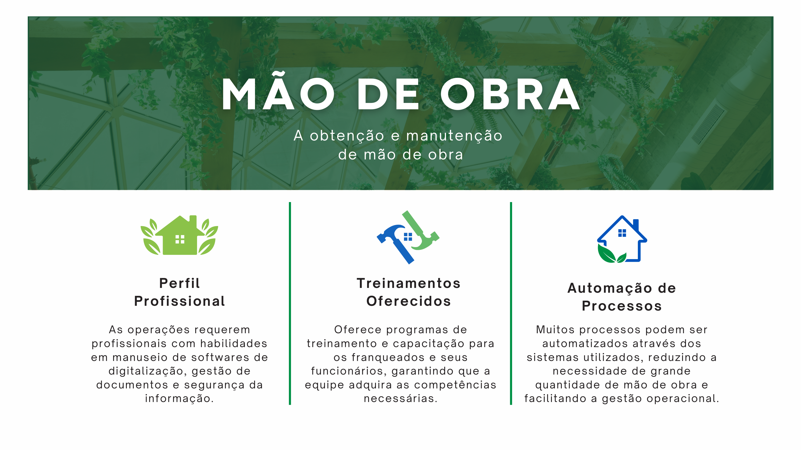 |
| **Page 08** - Management Ease | 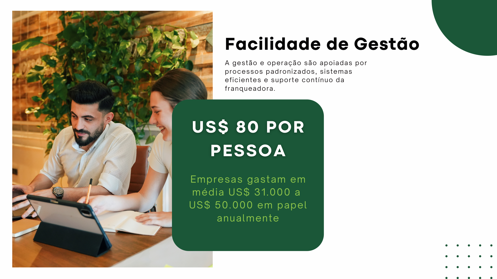 |
| **Page 09** - Future Goals | 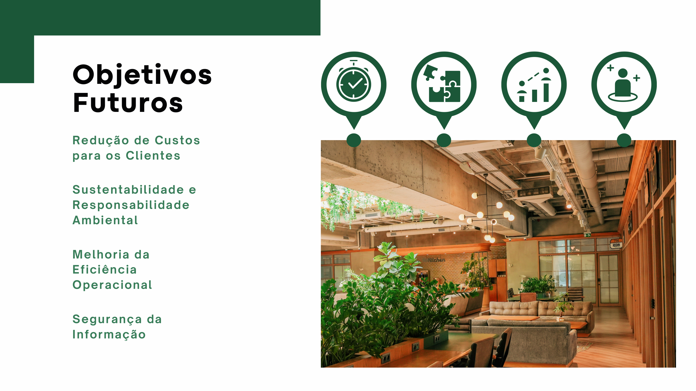 |
| **Page 10** - Our Team | 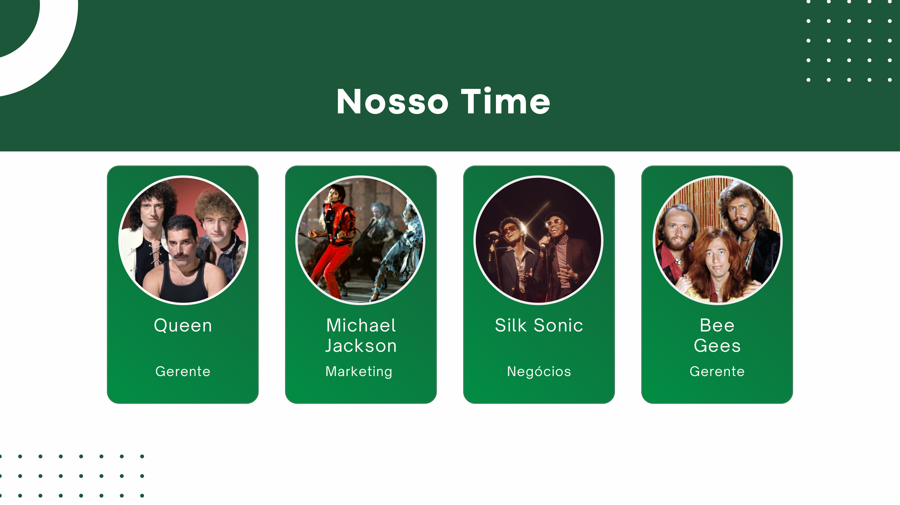 |
| **Page 11** - Thank You | 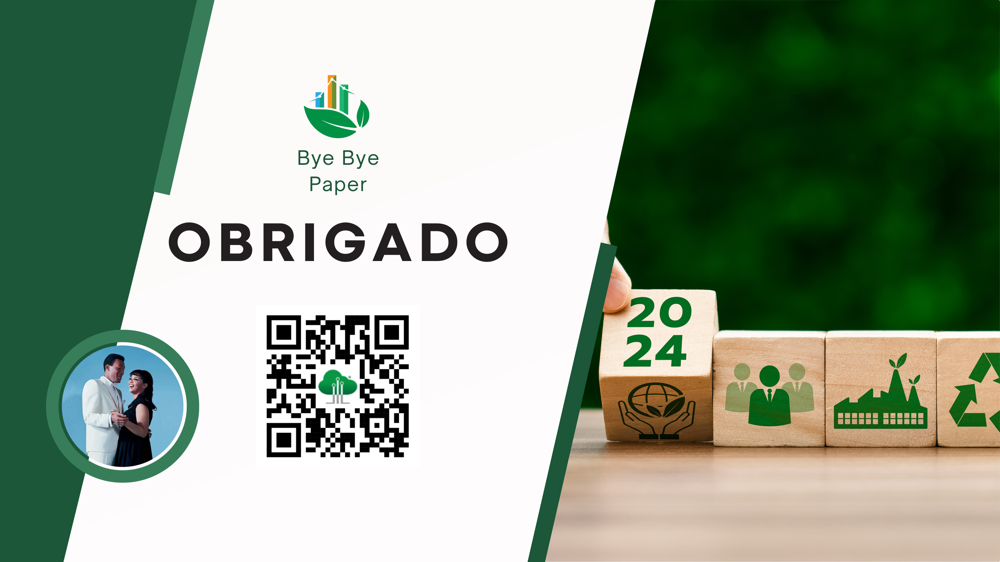 |

---
---

## 🇧🇷 Versão em Português

---

### 📖 Sobre o Projeto

A **Bye Bye Paper** é um modelo inovador de franquia focado em **gestão eletrônica de documentos e transformação digital (paperless)**. Ao auxiliar empresas a reduzirem o uso de papel e migrarem para fluxos de trabalho digitais, a Bye Bye Paper proporciona economia de custos, maior eficiência operacional e sustentabilidade ambiental.

#### Principais Tópicos da Apresentação:
1. **Implantação:**
   - Alta facilidade de implantação graças ao modelo de negócio 100% digital.
   - Não exige instalações físicas complexas.
   - Suporte completo ao franqueado, incluindo treinamento inicial e rápida configuração.
2. **Investimento:**
   - Baixo investimento inicial em relação às franquias tradicionais.
   - Custos operacionais reduzidos (licenciamento de software, manutenção e mão de obra).
   - Excelente potencial de ROI impulsionado pela alta demanda do mercado.
3. **Localização:**
   - Possibilidade de atuação em diversos locais e cidades de menor densidade populacional.
   - Flexibilidade para operar no formato **Home Office**, reduzindo custos fixos.
4. **Consumidores e Mercado:**
   - Alta aceitação de mercado, impulsionada pela preocupação com sustentabilidade e eficiência.
   - Empresas gastam em média entre **US$ 31.000 e US$ 50.000 em papel anualmente**.
5. **Mão de Obra e Automação:**
   - Processos automatizados que reduzem a necessidade de grandes equipes.
   - Capacitação e treinamentos contínuos oferecidos pela franqueadora.
6. **Facilidade de Gestão:**
   - Processos padronizados, sistemas eficientes e suporte contínuo.
7. **Objetivos Futuros:**
   - Redução de custos para os clientes, melhoria contínua da eficiência operacional, segurança da informação e responsabilidade ambiental.

---

### 🚀 Como Abrir e Visualizar o Projeto

1. **Visualização do arquivo PDF:**
   - Localize o arquivo `bye_bye_paper.pdf` na raiz do repositório.
   - Abra o arquivo clicando duas vezes ou arrastando-o para qualquer navegador (Chrome, Firefox, Edge, Safari) ou leitor de PDF (Adobe Acrobat, Leitor PDF do sistema).
2. **Visualização das Capturas de Tela (Screenshots):**
   - Navegue até a seção [Demonstração / Screenshots](#-demonstração--screenshots) abaixo para visualizar todos os slides em formato de imagem.

---

### 🖼️ Demonstração / Screenshots

| Slide | Pré-visualização |
| :---: | :--- |
| **Página 01** - Capa |  |
| **Página 02** - Tópicos |  |
| **Página 03** - Implantação |  |
| **Página 04** - Investimento |  |
| **Página 05** - Localização |  |
| **Página 06** - Consumidores |  |
| **Página 07** - Mão de Obra |  |
| **Página 08** - Facilidade de Gestão |  |
| **Página 09** - Objetivos Futuros |  |
| **Página 10** - Nosso Time |  |
| **Página 11** - Obrigado |  |
